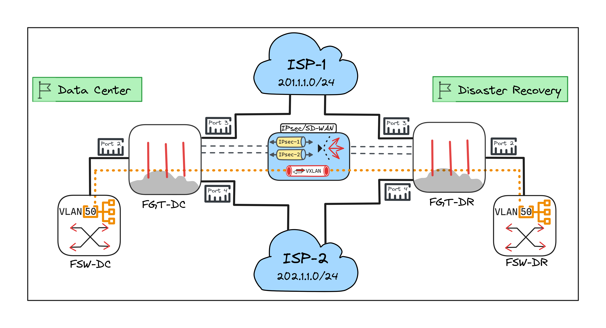

# FortiGate VXLAN using IPsec over SD-WAN
This document describes the configuration of VXLAN on 2x FortiGate each with 2x Uplinks using SD-WAN over IPsec VPN


 **FortiOS: v7.6.x** 


## Design

* **2x** Sites (*DC = Data Center*, *DR= Disaster Recovery*) 
* **2x** Uplinks for <ins>each</ins> FortiGate
* **1x** Local inside trunk port with *VLAN-50* as the VXLAN target
* **ISP-1** Subnet:
  * FGT-DC_Port3 = 201.1.1.1/24
  * FGT-DR_Port3 = 201.1.1.2/24
* **ISP-2** Subnet:
  * FGT-DC_Port4 = 202.1.1.1/24
  * FGT-DR_Port4 = 202.1.1.2/24
* **Loopback** Subnet:
  * FGT-DC_Loopback = 10.40.40.1/32
  * FGT-DR_Loopback = 10.40.40.2/32
* **VLAN** Subnet:
  * FGT_DC & FGT_DR Port2 <ins>Trunk/Sub</ins> interface
  * VLAN-50 = 172.16.50.0/24

## Topology


## MTU Prerequisites

> [!IMPORTANT] For LAB and Testing purposes you can **ignore** this or use a custom value based on your environment
* For real life scenarios kindly check the underlay MTU for your uplinks either it’s internet or local/MPLS, you may use:  
```
execute ping-options data-size 2000
execute ping-options df-bit yes
execute ping 201.1.1.2
```
* Making the uplink interface (underlay) with jumbo frames MTU will provide much performance and less complex configuration

* To Understand the VXLAN and IPsec MTU value check the bellow articles
  * [Technical Tip: How to analyze or plan VXLAN network deployment to avoid possible MTU issue](https://community.fortinet.com/fortigate-3/technical-tip-how-to-analyze-or-plan-vxlan-network-deployment-to-avoid-possible-mtu-issue-140275)
  * [Technical Tip: Understanding Maximum MTU on VXLAN Interfaces](https://community.fortinet.com/fortigate-3/technical-tip-understanding-maximum-mtu-on-vxlan-interfaces-194401)
* Total MTU overhead =  ~100 to 107 bytes
* Another solution is to lower IPsec and VXLAN interface MTU, but will not be covered in this documnet.


## 1 Basic Configuration 

### 1.1 Interface Settings
FGT-DC | FGT-DR 
--- | --- 
config system interface<br><ul>edit "port3"<br><ul>set vdom "root"<br>set ip 201.1.1.1 255.255.255.0<br>set allowaccess ping<br>set alias "ISP-1"<br></ul>next<br>edit "port4"<br><ul>set vdom "root"<br>set ip 202.1.1.1 255.255.255.0<br>set allowaccess ping<br>set alias "ISP-2"<br></ul>next<br><ul>edit "VLAN-50"<br>set vdom "root"<br>set interface "port2"<br>set vlanid 50<br></ul>next<br>edit "VXLAN-Loop"<br><ul>set vdom "root"<br>set ip 10.40.40.1 255.255.255.255<br>set allowaccess ping<br>set type loopback<br></ul>next<br></ul>end | config system interface<br><ul>edit "port3"<br><ul>set vdom "root"<br>set ip 201.1.1.2 255.255.255.0<br>set allowaccess ping<br>set alias "ISP-1"<br></ul>next<br>edit "port4"<br><ul>set vdom "root"<br>set ip 202.1.1.2 255.255.255.0<br>set allowaccess ping<br>set alias "ISP-2"<br></ul>next<br><ul>edit "VLAN-50"<br>set vdom "root"<br>set interface "port2"<br>set vlanid 50<br></ul>next<br>edit "VXLAN-Loop"<br><ul>set vdom "root"<br>set ip 10.40.40.2 255.255.255.255<br>set allowaccess ping<br>set type loopback<br></ul>next<br></ul>end

### 1.2 IPsec VPN - IKEv2 with PSK 
FGT-DC | FGT-DR 
--- | ---
config vpn ipsec phase1-interface<br><ul>edit "IPsec-T1"<br><ul>set interface "port3"<br>set ike-version 2<br>set peertype any<br>set net-device disable<br>set proposal aes256-sha256<br>set dhgrp 19<br>set nattraversal disable<br>set transport udp<br>set remote-gw 201.1.1.2<br>set psksecret ENC ******<br></ul>next<br>edit "IPsec-T2"<br><ul>set interface "port4"<br>set ike-version 2<br>set peertype any<br>set net-device disable<br>set proposal aes256-sha256<br>set dhgrp 19<br>set nattraversal disable<br>set transport udp<br>set remote-gw 202.1.1.2<br>set psksecret ENC ******<br></ul>next<br></ul>end | config vpn ipsec phase1-interface<br><ul>edit "IPsec-T1"<br><ul>set interface "port3"<br>set ike-version 2<br>set peertype any<br>set net-device disable<br>set proposal aes256-sha256<br>set dhgrp 19<br>set nattraversal disable<br>set transport udp<br>set remote-gw 201.1.1.1<br>set psksecret ENC ******<br></ul>next<br>edit "IPsec-T2"<br><ul>set interface "port4"<br>set ike-version 2<br>set peertype any<br>set net-device disable<br>set proposal aes256-sha256<br>set dhgrp 19<br>set nattraversal disable<br>set transport udp<br>set remote-gw 202.1.1.1<br>set psksecret ENC ******<br></ul>next<br></ul>end
config vpn ipsec phase2-interface<br><ul>edit "IPsec-T1"<br><ul>set phase1name "IPsec-T1"<br>set proposal aes256-sha256<br>set dhgrp 19<br>set auto-negotiate enable<br></ul>next<br>edit "IPsec-T2"<br><ul>set phase1name "IPsec-T2"<br>set proposal aes256-sha256<br>set dhgrp 19<br>set auto-negotiate enable<br></ul>next<br></ul>end | config vpn ipsec phase2-interface<br><ul>edit "IPsec-T1"<br><ul>set phase1name "IPsec-T1"<br>set proposal aes256-sha256<br>set dhgrp 19<br>set auto-negotiate enable<br></ul>next<br>edit "IPsec-T2"<br><ul>set phase1name "IPsec-T2"<br>set proposal aes256-sha256<br>set dhgrp 19<br>set auto-negotiate enable<br></ul>next<br></ul>end
config system interface<br><ul>edit "IPsec-T1"<br><ul>set vdom "root"<br>set ip 10.10.10.1 255.255.255.255<br>set type tunnel<br>set remote-ip 10.10.10.2 255.255.255.252<br>set interface "port3"<br></ul>next<br>edit "IPsec-T2"<br><ul>set vdom "root"<br>set ip 10.20.20.1 255.255.255.255<br>set type tunnel<br>set remote-ip 10.20.20.2 255.255.255.252<br>set interface "port4"<br></ul>next<br></ul>end | config system interface<br><ul>edit "IPsec-T1"<br><ul>set vdom "root"<br>set ip 10.10.10.2 255.255.255.255<br>set type tunnel<br>set remote-ip 10.10.10.1 255.255.255.252<br>set interface "port3"<br></ul>next<br>edit "IPsec-T2"<br><ul>set vdom "root"<br>set ip 10.20.20.2 255.255.255.255<br>set type tunnel<br>set remote-ip 10.20.20.1 255.255.255.252<br>set interface "port4"<br></ul>next<br></ul>end

## 2 SD-WAN Configuration 

### 2.1 Overlay Zone and Members 
FGT-DC | FGT-DR 
--- | --- 
config system sdwan<br><ul>set status enable<br>config zone<br><ul>edit "SDW-VXLAN"<br>next<br></ul>end<br>config members<br><ul>edit 1<br><ul>set interface "IPsec-T1"<br>set zone "SDW-VXLAN"<br>set gateway 10.10.10.2<br></ul>next<br>edit 2<br><ul>set interface "IPsec-T2"<br>set zone "SDW-VXLAN"<br>set gateway 10.20.20.2<br></ul>next<br></ul>end<br></ul>end | config system sdwan<br><ul>set status enable<br>config zone<br><ul>edit "SDW-VXLAN"<br>next<br></ul>end<br>config members<br><ul>edit 1<br><ul>set interface "IPsec-T1"<br>set zone "SDW-VXLAN"<br>set gateway 10.10.10.1<br></ul>next<br>edit 2<br><ul>set interface "IPsec-T2"<br>set zone "SDW-VXLAN"<br>set gateway 10.20.20.1<br></ul>next<br></ul>end<br></ul>end

### 2.2 Route for Loopback only 
FGT-DC | FGT-DR 
--- | --- 
config router static<br><ul>edit 1<br><ul>set dst 10.40.40.2 255.255.255.255<br>set distance 1<br>set sdwan-zone "SDW-VXLAN"<br></ul>next<br></ul>end | config router static<br><ul>edit 1<br><ul>set dst 10.40.40.1 255.255.255.255<br>set distance 1<br>set sdwan-zone "SDW-VXLAN"<br></ul>next<br></ul>end

### 3.3 Policy for Loopback IP 
That will the VXLAN communication uses later over 2 or more tunnels
FGT-DC | FGT-DR 
--- | --- 
config system settings<br><ul>set gui-multiple-interface-policy enable<br></ul>end | config system settings<br><ul>set gui-multiple-interface-policy enable<br></ul>end
config firewall policy<br><ul>edit 1<br><ul>set name "SDW<>Lo VXLAN"<br>set srcintf "SDW-VXLAN" "VXLAN-Loop"<br>set dstintf "SDW-VXLAN" "VXLAN-Loop"<br>set action accept<br>set srcaddr "10.40.40.1" "10.40.40.2"<br>set dstaddr "10.40.40.1" "10.40.40.2"<br>set schedule "always"<br>set service "ALL"<br>set logtraffic all<br></ul>next<br></ul>end | config firewall policy<br><ul>edit 1<br><ul>set name "SDW<>Lo VXLAN"<br>set srcintf "SDW-VXLAN" "VXLAN-Loop"<br>set dstintf "SDW-VXLAN" "VXLAN-Loop"<br>set action accept<br>set srcaddr "10.40.40.1" "10.40.40.2"<br>set dstaddr "10.40.40.1" "10.40.40.2"<br>set schedule "always"<br>set service "ALL"<br>set logtraffic all<br></ul>next<br></ul>end

## 3 VXLAN Configuration

### 3.1 Interface Settings
FGT-DC | FGT-DR
--- | ---
config system vxlan<br><ul>edit "vxlan.50"<br><ul>set interface "VXLAN-Loop"<br>set vni 50<br>set remote-ip "10.40.40.2"<br></ul>next<br></ul>end | config system vxlan<br><ul>edit "vxlan.50"<br><ul>set interface "VXLAN-Loop"<br>set vni 50<br>set remote-ip "10.40.40.1"<br></ul>next<br></ul>end

### 3.1 Software Switch
FGT-DC | FGT-DR
--- | ---
config system switch-interface<br><ul>edit "VXLAN-50"<br><ul>set vdom "root"<br>set member "VLAN-50" "vxlan.50"<br></ul>next<br></ul>end | config system switch-interface<br><ul>edit "VXLAN-50"<br><ul>set vdom "root"<br>set member "VLAN-50" "vxlan.50"<br></ul>next<br></ul>end
config system interface<br><ul>edit "VXLAN-50"<br><ul>set vdom "root"<br>set ip 172.16.50.11 255.255.255.0<br>set allowaccess ping<br></ul>next<br></ul>end | config system interface<br><ul>edit "VXLAN-50"<br><ul>set vdom "root"<br>set ip 172.16.50.12 255.255.255.0<br>set allowaccess ping<br></ul>next<br></ul>end

## 4 Verification
1. Ping From FGT-DC to 172.16.50.12
2. `diagnose sys vxlan fdb list vxlan.50`


## Authors

* **Omar Adil** - [Linkedin](https://www.linkedin.com/in/omaradil/)


## License

This project is licensed under the MIT License - see the [LICENSE.md](LICENSE.md) file for details


## Acknowledgments

* [Obsidian](https://obsidian.md/)
* [Excalidraw](https://excalidraw.com/)

